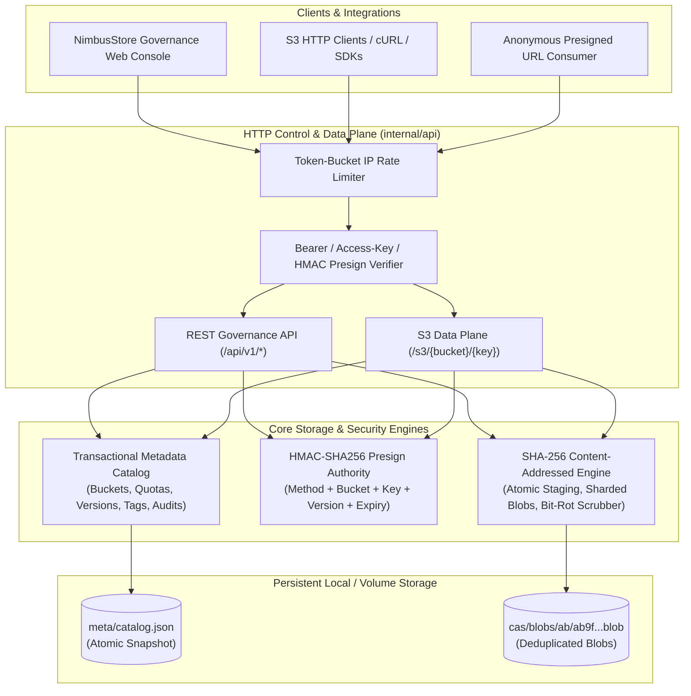

# NimbusStore

[](https://github.com/fully-ai/nimbusstore/actions/workflows/ci.yml)
[](https://github.com/fully-ai/nimbusstore/releases)
[](https://go.dev/)
[](LICENSE)
[](#4-content-addressed-storage-cas--deduplication-engine)

> **Self-Hosted S3-Compatible Content-Addressed Object Storage, Immutable Versioning, HMAC-SHA256 Presigned URLs, Bit-Rot Integrity Scrubbing & Bucket Governance Platform.**

---

## Table of Contents
1. [Executive Overview](#1-executive-overview)
2. [Key Features & Capabilities](#2-key-features--capabilities)
3. [System Architecture & Data Flow](#3-system-architecture--data-flow)
4. [Content-Addressed Storage (CAS) & Deduplication Engine](#4-content-addressed-storage-cas--deduplication-engine)
5. [Immutable Object Versioning & Delete Markers](#5-immutable-object-versioning--delete-markers)
6. [Cryptographic Presigned URL Engine](#6-cryptographic-presigned-url-engine)
7. [Bit-Rot Scrubbing & Self-Verification](#7-bit-rot-scrubbing--self-verification)
8. [NimbusStore Governance Web Console](#8-nimbusstore-governance-web-console)
9. [Quick Start (Local Binary & Demo Mode)](#9-quick-start-local-binary--demo-mode)
10. [Docker & Docker Compose Deployment](#10-docker--docker-compose-deployment)
11. [Configuration & Environment Variables](#11-configuration--environment-variables)
12. [REST & S3-Compatible HTTP API Reference](#12-rest--s3-compatible-http-api-reference)
13. [End-to-End cURL Cookbook](#13-end-to-end-curl-cookbook)
14. [Authentication, Authorization & Rate Limiting](#14-authentication-authorization--rate-limiting)
15. [Backup, Disaster Recovery & Catalog Snapshots](#15-backup-disaster-recovery--catalog-snapshots)
16. [Observability, Metrics & Audit Trails](#16-observability-metrics--audit-trails)
17. [Repository Layout](#17-repository-layout)
18. [Testing, Race Detection & Verification](#18-testing-race-detection--verification)
19. [Security Model & Threat Mitigations](#19-security-model--threat-mitigations)
20. [Roadmap & License](#20-roadmap--license)

---

## 1. Executive Overview

**NimbusStore** is a lightweight, deterministic, zero-external-dependency object storage server and governance platform written in Go. Unlike traditional file-per-key object stores that duplicate identical files across versions, keys, or buckets, NimbusStore separates the **logical S3 metadata catalog** from a **SHA-256 Content-Addressable Storage (CAS) physical blob engine**.

Whenever an object version is uploaded via the S3 data plane (`PUT /s3/{bucket}/{key}`), the REST API (`POST /api/v1/buckets/{bucket}/objects`), or the interactive Web Console:
1. Payload bytes stream into an isolated temporary file while computing a cryptographic SHA-256 digest.
2. If a blob with the same SHA-256 digest already exists on disk, NimbusStore links the new object version to the existing physical blob in $O(1)$ time—consuming **zero additional disk bytes** and recording a deduplication hit.
3. Bucket quotas (`quota_mb`), immutable version stacks, custom metadata tags (`X-Amz-Meta-*`), and structured audit logs are transactionally persisted via atomic write-ahead snapshots.

---

## 2. Key Features & Capabilities

| Capability | Description |
| :--- | :--- |
| **SHA-256 Content-Addressable Blobs** | Two-level hex-sharded blob layout (`blobs/<2-char-prefix>/<sha256>.blob`) with atomic temp-to-final rename writes. |
| **Global Cross-Bucket Deduplication** | Identical payloads uploaded across different object keys, versions, or buckets are stored physically once on disk. |
| **Immutable Object Versioning** | Per-bucket versioning policy maintains complete version stacks (`VersionID`, `IsLatest`, `IsDeleteMarker`) and point-in-time retrieval via `?versionId=`. |
| **Bucket Quotas & Governance** | Enforce hard per-bucket capacity limits (`quota_mb`), public-read policies (`public_read`), and lifecycle retention windows (`retention_days`). |
| **HMAC-SHA256 Presigned URLs** | Generate time-limited, method-bound (`GET`/`PUT`) signed URLs verified in constant time via `crypto/hmac`. |
| **Bit-Rot Integrity Scrubber** | On-demand full-disk SHA-256 verification (`POST /api/v1/scrub`) detects silent disk corruption or bit flips. |
| **Transactional Backup & Restore** | Online JSON catalog snapshot export (`GET /api/v1/admin/backup`) and point-in-time restore (`POST /api/v1/admin/restore`). |
| **Interactive Governance Console** | Built-in Sky-Blue/Cobalt dark & light UI for managing buckets, uploading objects, exploring versions, presigning URLs, scrubbing blobs, and auditing access. |

---

## 3. System Architecture & Data Flow



---

## 4. Content-Addressed Storage (CAS) & Deduplication Engine

Located in `internal/cas/engine.go`, the CAS engine guarantees crash-safe writes and deterministic deduplication:
- **Streaming MultiWriter Ingestion**: Incoming streams are written to `cas/tmp/upload-*.part` while simultaneously feeding `crypto/sha256` and enforcing `maxObjectBytes`.
- **Fsync + Atomic Rename**: Temporary files are flushed (`Sync()`) before checking whether `cas/blobs/<hash[:2]>/<hash>.blob` exists.
- **Zero-Copy Deduplication**: When a digest match is found, the temporary file is unlinked and `DedupHits` + `DedupBytesSaved` counters increment immediately.

---

## 5. Immutable Object Versioning & Delete Markers

When `versioning_enabled: true` is configured on a bucket:
- Uploading to an existing `bucket/key` prepends a new `ObjectVersion` (`v_<timestamp>_<random>`) as `is_latest: true` while preserving all historical versions.
- Deleting an object via `DELETE /s3/{bucket}/{key}` or `DELETE /api/v1/buckets/{bucket}/objects?key=...` without a `versionId` inserts an immutable **Delete Marker** (`dm_<timestamp>_<random>`).
- Standard `GET /s3/{bucket}/{key}` requests return `404 Not Found` once a delete marker is latest, while historical versions remain addressable via `GET /s3/{bucket}/{key}?versionId=<id>`.
- Specifying `?versionId=<id>` on `DELETE` permanently removes that specific version or delete marker.

---

## 6. Cryptographic Presigned URL Engine

`internal/signing/presign.go` signs canonical multi-line payloads:

```text
NIMBUS-HMAC-SHA256
<HTTP_METHOD>
<BUCKET_NAME>
<OBJECT_KEY>
<OPTIONAL_VERSION_ID>
<EXPIRES_UNIX_TIMESTAMP>
```

Query parameters attached to `/s3/{bucket}/{key}`:
- `X-Nimbus-Method`: Bound HTTP method (`GET` or `PUT`).
- `X-Nimbus-Expires`: Unix epoch expiration timestamp in UTC.
- `versionId`: Optional pinned immutable version ID.
- `X-Nimbus-Signature`: Hex-encoded HMAC-SHA256 digest verified with `hmac.Equal`.

---

## 7. Bit-Rot Scrubbing & Self-Verification

Silent storage media corruption ("bit-rot") can degrade archival objects over time without filesystem errors. NimbusStore includes an active scrubber (`POST /api/v1/scrub` and `Engine.ScrubAll()`):
- Walks every stored `.blob` shard on disk.
- Streams raw bytes through `sha256.New()` and compares the computed digest against the expected content-addressed filename.
- Produces a structured `ScrubReport` (`total_blobs`, `verified_blobs`, `corrupted_count`, `corrupted_blobs`, `total_bytes_verified`, `duration_ms`, `healthy`) and logs an audit event.

---

## 8. NimbusStore Governance Web Console

Navigate to `http://localhost:8095/` in any browser to access the embedded **NimbusStore Object & Bucket Governance Console**:
- **Overview & Deduplication Telemetry**: Real-time logical vs. physical CAS bytes, deduplication hits, bytes saved, and bucket quota progress bars.
- **Buckets & Quotas**: Create or update bucket policies (`quota_mb`, `versioning_enabled`, `public_read`, `retention_days`).
- **Object Explorer & Versions**: Filter objects by key prefix, toggle historical versions & delete markers, inspect SHA-256 digests, download specific versions, or one-click presign.
- **Object Uploader**: Upload files or raw text/JSON payloads with custom `Content-Type` and `k=v` tags and view immediate CAS deduplication receipts.
- **Presigned URL Studio**: Generate expiring `GET` or `PUT` URLs and test them directly.
- **Bit-Rot Scrubber & Snapshot Backup**: Trigger full-disk SHA-256 scrubs and export/restore catalog snapshots.
- **Governance Audit Logs**: Inspect the real-time audit trail of every control-plane and data-plane operation.

---

## 9. Quick Start (Local Binary & Demo Mode)

```bash
# Clone the repository
git clone https://github.com/fully-ai/nimbusstore.git
cd nimbusstore

# Build the single static binary
go build -o bin/nimbusstore ./cmd/nimbusstore

# Launch with demo buckets & deduplicated object versions seeded automatically
./bin/nimbusstore -addr :8095 -data-dir ./data -seed-demo=true
```

Open `http://localhost:8095` in your browser.

---

## 10. Docker & Docker Compose Deployment

```bash
# Build and start NimbusStore with persistent volume storage
docker compose up --build -d

# Check service health
curl -s http://localhost:8095/healthz | jq .
```

---

## 11. Configuration & Environment Variables

| Flag | Environment Variable | Default | Description |
| :--- | :--- | :--- | :--- |
| `-addr` | `NIMBUS_ADDR` | `:8095` | HTTP listen address (`host:port`). |
| `-data-dir` | `NIMBUS_DATA_DIR` | `./data` | Root directory for `cas/` blobs and `meta/catalog.json`. |
| `-seed-demo` | `NIMBUS_SEED_DEMO` | `true` | Seed sample buckets and deduplicated objects when catalog is empty. |
| — | `NIMBUS_API_TOKEN` | *(empty)* | Optional Bearer token for control/data plane authentication. |
| — | `NIMBUS_ACCESS_KEY` | *(empty)* | Optional S3-style access key header (`X-Nimbus-Access-Key`). |
| — | `NIMBUS_SECRET_KEY` | *(empty)* | Optional S3-style secret key header (`X-Nimbus-Secret-Key`). |
| — | `NIMBUS_SIGNING_SECRET` | `nimbusstore-default-hmac-signing-secret` | Secret key used for HMAC-SHA256 presigned URLs. |

---

## 12. REST & S3-Compatible HTTP API Reference

| Method & Path | Description |
| :--- | :--- |
| `GET /` | Serve the NimbusStore Object & Bucket Governance Console UI. |
| `GET /healthz` | Liveness, CAS scrub health status, and uptime telemetry. |
| `GET /metrics` | Detailed CAS physical stats, deduplication savings, and logical catalog metrics. |
| `GET /api/v1/buckets` | List all configured buckets and their quota utilization. |
| `POST /api/v1/buckets` | Create or update a bucket governance policy (`name`, `quota_mb`, `versioning_enabled`, `public_read`, `retention_days`). |
| `GET /api/v1/buckets/{bucket}` | Retrieve metadata and usage counters for a single bucket. |
| `DELETE /api/v1/buckets/{bucket}` | Delete a bucket and its catalog metadata records. |
| `GET /api/v1/buckets/{bucket}/objects` | List objects in a bucket (`?prefix=...&versions=true`). |
| `POST /api/v1/buckets/{bucket}/objects` | Upload an object version (`?key=path/file.ext&tags=k1=v1,k2=v2`). |
| `DELETE /api/v1/buckets/{bucket}/objects` | Delete an object key (creates delete marker if versioned) or specific `?versionId=`. |
| `PUT /s3/{bucket}/{key}` | S3-compatible direct object upload (returns `ETag`, `X-Nimbus-Version-Id`, `X-Nimbus-Deduplicated`). |
| `GET /s3/{bucket}/{key}` | S3-compatible object download (supports `?versionId=`, presigned URL query params, or `public_read`). |
| `HEAD /s3/{bucket}/{key}` | Retrieve object headers (`ETag`, `Content-Length`, `X-Nimbus-Version-Id`, `X-Amz-Meta-*`) without body. |
| `DELETE /s3/{bucket}/{key}` | S3-compatible object or version deletion. |
| `POST /api/v1/presign` | Generate an expiring HMAC-SHA256 presigned `GET` or `PUT` URL. |
| `POST /api/v1/scrub` | Execute a full SHA-256 bit-rot verification scrub across all stored CAS blobs. |
| `GET /api/v1/audits` | List recent governance and data-plane audit events. |
| `GET /api/v1/admin/backup` | Export a full transactional JSON snapshot of the metadata catalog. |
| `POST /api/v1/admin/restore` | Restore a transactional JSON catalog snapshot. |

---

## 13. End-to-End cURL Cookbook

```bash
# 1. Create a versioned bucket with a 25 MB quota
curl -s -X POST http://localhost:8095/api/v1/buckets \
  -H "Content-Type: application/json" \
  -d '{"name":"models-vault","quota_mb":25,"versioning_enabled":true,"public_read":false,"retention_days":180}'

# 2. Upload an object via the S3 PUT endpoint with custom metadata tags
curl -i -X PUT "http://localhost:8095/s3/models-vault/embeddings/config.json?tags=env=prod,owner=ml" \
  -H "Content-Type: application/json" \
  -d '{"dim":1536,"model":"nimbus-embed-v1"}'

# 3. Upload identical content to a second key (triggers automatic SHA-256 CAS deduplication)
curl -i -X PUT "http://localhost:8095/s3/models-vault/embeddings/config-replica.json" \
  -H "Content-Type: application/json" \
  -d '{"dim":1536,"model":"nimbus-embed-v1"}'

# 4. Generate a 10-minute Presigned GET URL
PRESIGNED=$(curl -s -X POST http://localhost:8095/api/v1/presign \
  -H "Content-Type: application/json" \
  -d '{"method":"GET","bucket":"models-vault","key":"embeddings/config.json","ttl_seconds":600,"base_url":"http://localhost:8095"}' | jq -r .url)

# 5. Download object anonymously using the Presigned URL
curl -s "$PRESIGNED"

# 6. Run full SHA-256 Bit-Rot Integrity Scrub
curl -s -X POST http://localhost:8095/api/v1/scrub | jq .
```

---

## 14. Authentication, Authorization & Rate Limiting

- **Bearer & Access-Key Authentication**: When `NIMBUS_API_TOKEN` or `NIMBUS_ACCESS_KEY`/`NIMBUS_SECRET_KEY` are configured, mutating control-plane routes and private bucket reads require valid credentials verified with `subtle.ConstantTimeCompare`.
- **Public-Read Bucket Policy**: Buckets with `public_read: true` allow unauthenticated `GET` and `HEAD` requests on `/s3/{bucket}/{key}` while still requiring authentication for writes and deletes.
- **Presigned URL Delegation**: Any client possessing an unexpired, method-matched `X-Nimbus-Signature` query string can perform the signed `GET` or `PUT` operation on `/s3/{bucket}/{key}`.
- **Per-IP Token-Bucket Rate Limiter**: Protects the server from abusive request floods (`429 Too Many Requests`).

---

## 15. Backup, Disaster Recovery & Catalog Snapshots

- All bucket definitions, object version trees, tags, and audit trails are stored in `meta/catalog.json` via atomic write-then-rename (`catalog.json.tmp` -> `catalog.json`).
- Operators can export consistent point-in-time JSON snapshots via `GET /api/v1/admin/backup` and restore them onto any instance via `POST /api/v1/admin/restore`.

---

## 16. Observability, Metrics & Audit Trails

`GET /metrics` exposes structured telemetry for Prometheus collectors or dashboards:
- `cas.unique_blobs`, `cas.physical_bytes`, `cas.total_puts`, `cas.dedup_hits`, `cas.dedup_bytes_saved`, `cas.last_scrub`
- `catalog.total_buckets`, `catalog.total_active_keys`, `catalog.total_versions`, `catalog.total_logical_bytes`
- `deduplication_ratio`: Ratio of logical object storage to physical CAS bytes on disk.

---

## 17. Repository Layout

```text
nimbusstore/
├── cmd/nimbusstore/
│   └── main.go                 # CLI entrypoint, demo seeder & graceful HTTP shutdown
├── internal/
│   ├── api/
│   │   ├── server.go           # REST control plane, S3 data plane, auth & rate limiter
│   │   └── server_test.go      # End-to-end API, quota, versioning, presign & scrub tests
│   ├── cas/
│   │   ├── engine.go           # SHA-256 Content-Addressed Storage & bit-rot scrubber
│   │   └── engine_test.go      # Deduplication, bit-rot detection & traversal tests
│   ├── signing/
│   │   ├── presign.go          # HMAC-SHA256 presigned URL generator & verifier
│   │   └── presign_test.go     # Expiry, method binding & signature tamper tests
│   ├── storage/
│   │   └── catalog.go          # Transactional bucket, quota, version & audit catalog
│   └── web/
│       └── ui.go               # Embedded NimbusStore Object & Bucket Governance Console
├── .github/workflows/ci.yml    # Automated Go vet, race-enabled test & build pipeline
├── Dockerfile                  # Multi-stage distroless/alpine container build
├── docker-compose.yml          # One-command container stack with persistent volume
├── .env.example                # Sample environment variables
├── CHANGELOG.md                # Release history
├── LICENSE                     # MIT License
├── PROJECT_PLAN.md             # Architectural blueprint
└── README.md                   # Comprehensive documentation
```

---

## 18. Testing, Race Detection & Verification

```bash
# Static analysis
go vet ./...

# Execute full test suite with Go race detector enabled
go test -v -race ./...

# Compile binary
go build ./...
```

---

## 19. Security Model & Threat Mitigations

- **Path Traversal Prevention**: CAS blob lookups enforce strict 64-character lowercase hex validation (`ValidateHash`), and object keys reject `..` segments and null bytes.
- **Constant-Time Cryptography**: Both HMAC-SHA256 presigned signature verification (`hmac.Equal`) and API token comparison (`subtle.ConstantTimeCompare`) run in constant time.
- **Quota Rollback Protection**: If a newly uploaded object exceeds a bucket's `quota_mb`, the catalog rejects the version and unlinks any non-deduplicated staging blob so physical disk space cannot be exhausted by rejected uploads.
- **Hardened HTTP Headers**: Every response sets `X-Content-Type-Options: nosniff`, `X-Frame-Options: DENY`, and `Referrer-Policy: no-referrer`.

---

## 20. Roadmap & License

### Roadmap
- [ ] Background scheduled bit-rot scrubbing & unreferenced CAS blob garbage collection worker.
- [ ] Multipart chunked S3 upload (`InitiateMultipartUpload` / `UploadPart` / `CompleteMultipartUpload`).
- [ ] Optional webhooks on bucket quota threshold or bit-rot detection events.

### License
Released under the [MIT License](LICENSE).
